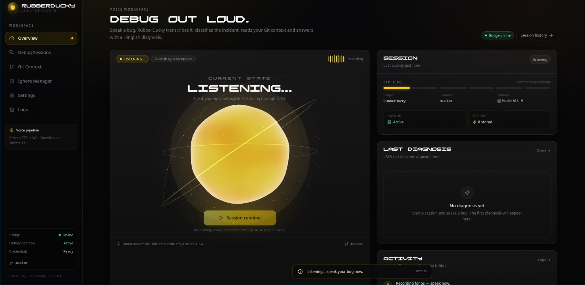
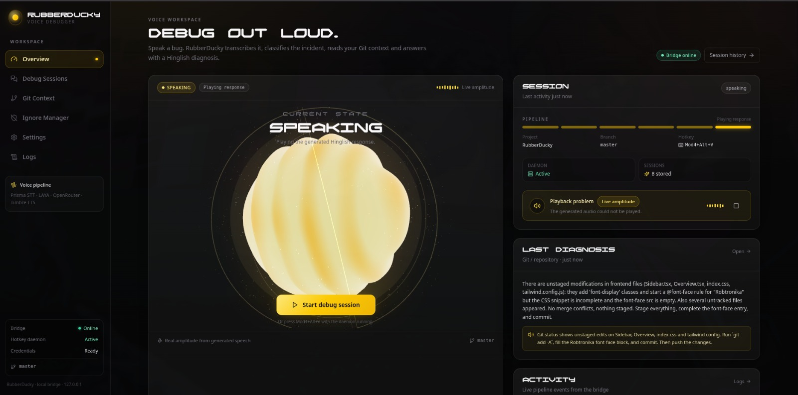
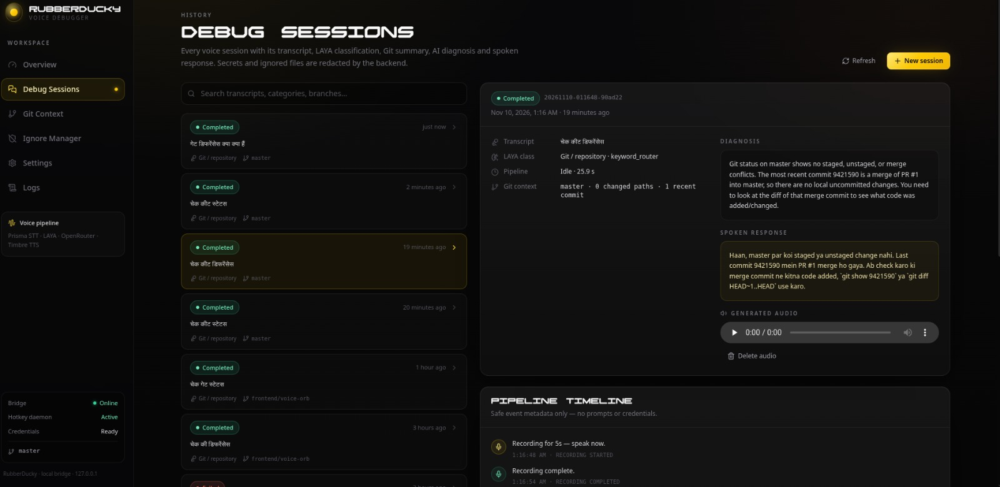
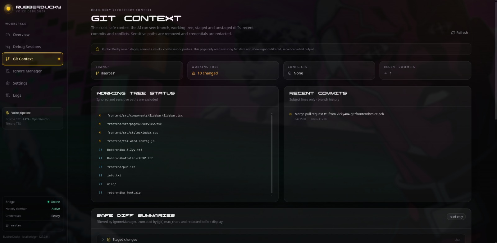

# 🦆 RubberDucky

### Debug out loud. Let your voice drive the debugging workflow.

**RubberDucky** is a voice-native Linux debugging assistant that helps developers investigate software issues using natural speech.

Describe a problem in Hindi or Hinglish, and RubberDucky records your voice, transcribes it, classifies the issue, gathers relevant Git context, requests an AI-generated diagnosis, and speaks the response back to you.

It combines a terminal-native Python workflow with a browser-based dashboard, a local FastAPI backend, an X11 global hotkey daemon, and AI-powered incident triage.

The goal is simple: **make debugging feel like talking through a problem with another developer.**

---

## ✨ Features

| Feature | Description |
|---|---|
| 🎙️ Voice debugging | Describe development problems through your microphone |
| 🌐 Hindi / Hinglish | Speech transcription and spoken responses using Gnani |
| 🧠 AI diagnosis | Uses OpenRouter to generate structured debugging suggestions |
| 🔍 LAYA triage | Classifies incidents using keyword routing and the LAYA classifier |
| 🌿 Git awareness | Collects repository status, branches, diffs, conflicts and recent commits |
| 🐳 Docker context | Optional container-log collection for infrastructure issues |
| 🔊 Voice response | Generates spoken responses through Gnani Timbre |
| 🖥️ Web dashboard | Interactive browser-based debugging workspace |
| 🗂️ Session history | Review previous transcripts, diagnoses, audio and event timelines |
| 🛡️ Ignore Manager | Detects sensitive files and suggests repository ignore patterns |
| ⚡ Global hotkey | Launch the CLI workflow using a configurable X11 shortcut |
| 🎨 Custom interface | Dark interface with animated 3D orb and Robtronika display typography |

RubberDucky is an assistant, not an autonomous coding agent. It does not automatically modify source code, execute AI-generated shell commands, or guarantee that a diagnosis is correct.

---

## 🖼️ Screenshots

### Voice workspace — Listening



### Voice workspace — Speaking



### Debug sessions



### Git context



---

## ⚙️ How It Works

A debugging session follows this pipeline:

1. **Voice Capture** — ALSA records the user's voice locally.
2. **Speech Recognition** — Gnani Prisma converts the recording into text.
3. **Context Collection** — RubberDucky collects relevant Git information from the current repository.
4. **Incident Classification** — Keyword rules and LAYA classify the issue.
5. **AI Diagnosis** — The transcript and sanitized context are sent to the configured OpenRouter model.
6. **Response Generation** — The model returns a structured diagnosis and a spoken response.
7. **Text-to-Speech** — Gnani Timbre generates audio.
8. **Session Review** — The result, timeline, transcript and generated audio are available in the dashboard.

### Architecture

```text
                  LINUX DESKTOP (X11)
                          |
                  Mod4 + Alt + V
                          |
                   C++ X11 DAEMON
                          |
                    PYTHON CLI
                          |
                   ALSA RECORDING
                          |
                    GNANI PRISMA
                          |
                  SPEECH TRANSCRIPT
                          |
               +----------+-----------+
               |                      |
           GIT CONTEXT           LAYA TRIAGE
               |                      |
               +----------+-----------+
                          |
                 OPTIONAL DOCKER LOGS
                          |
                    OPENROUTER
                          |
                 AI DIAGNOSIS (JSON)
                          |
                    GNANI TIMBRE
                          |
                    AUDIO OUTPUT


              BROWSER-BASED DASHBOARD
                          |
                 REACT + TYPESCRIPT
                          |
                  HTTP + WEBSOCKETS
                          |
                   FASTAPI BRIDGE
                          |
                SESSION RUNNER / STORE
                          |
                 SHARED PYTHON PIPELINE
```

The CLI and web dashboard use the same core debugging pipeline. The CLI handles terminal interaction and local playback, while FastAPI manages browser sessions, WebSocket events, persistence and audio delivery.

---

## 🧱 Tech Stack

### Backend
- Python 3.13+
- FastAPI
- Uvicorn
- Pydantic
- ALSA (`arecord`, `aplay`)
- `uv` for dependency management

### AI and Speech
- OpenRouter — LLM diagnosis
- LAYA — incident classification
- Gnani Prisma — Speech-to-Text
- Gnani Timbre — Text-to-Speech

### Frontend
- React 18
- TypeScript
- Vite
- Zustand
- Tailwind CSS
- Three.js
- React Three Fiber
- Lucide Icons

### System Integration
- C++17
- X11 / Xlib
- Linux process management
- Git CLI
- Docker CLI (optional)

### Interface Design
- Dark developer-focused interface
- Animated 3D voice orb
- Glass-style panels
- Amber/yellow accent palette
- Robtronika display font

---

## 📁 Project Structure

```text
RubberDucky/
│
├── frontend/
│   ├── public/
│   │   └── fonts/
│   │       ├── Robtronika.ttf
│   │       └── Robtronika-Italic.ttf
│   │
│   └── src/
│       ├── components/
│       │   ├── Orb/
│       │   ├── Git/
│       │   ├── Session/
│       │   ├── Sidebar/
│       │   ├── Status/
│       │   └── ui/
│       │
│       ├── hooks/
│       ├── lib/
│       ├── pages/
│       ├── services/
│       ├── stores/
│       ├── styles/
│       └── types/
│
├── Screenshots/
│   ├── Orb_Listening.jpeg
│   ├── Orb_Speaking.jpeg
│   ├── Debug_Sessions.jpeg
│   └── Git_Contex.jpeg
│
├── src/
│   ├── api/
│   │   ├── stt.py
│   │   └── tts.py
│   │
│   ├── core/
│   │   ├── config.py
│   │   ├── context.py
│   │   ├── debuglog.py
│   │   ├── git_ops.py
│   │   ├── ignore.py
│   │   ├── llm_client.py
│   │   ├── parser.py
│   │   ├── pipeline.py
│   │   ├── repository.py
│   │   └── triage.py
│   │
│   ├── daemon/
│   │   └── main.cpp
│   │
│   ├── server/
│   │   ├── app.py
│   │   ├── config_writer.py
│   │   ├── events.py
│   │   ├── git_service.py
│   │   ├── models.py
│   │   ├── session_runner.py
│   │   └── session_store.py
│   │
│   ├── ducky.py
│   └── manage_ignores.py
│
├── tests/
├── .env.example
├── .gitignore
├── .rubberduckyignore
├── misc/
│   └── License.txt
├── pyproject.toml
├── rubberducky.ini
├── uv.lock
└── README.md
```

---

## 🚀 Installation

### 1. Clone the repository

```bash
git clone https://github.com/Vicky404-git/RubberDucky.git

cd RubberDucky
```

### 2. Install system dependencies

For Debian 13 / Ubuntu:

```bash
sudo apt update

sudo apt install \
    build-essential \
    g++ \
    libx11-dev \
    libx11-6 \
    alsa-utils
```

Check your microphone and audio devices:

```bash
arecord -l
aplay -l
```

### 3. Install Python dependencies

Install [uv](https://docs.astral.sh/uv/) if it is not already installed.

Then run:

```bash
uv sync
```

This creates the project virtual environment and installs the Python dependencies.

### 4. Configure environment variables

Create your local `.env` file:

```bash
cp .env.example .env
```

Add your credentials:

```env
GNANI_API=YOUR_GNANI_API_KEY
OPENROUTER_API_KEY=YOUR_OPENROUTER_API_KEY
```

Never commit `.env` or expose API keys in frontend code.

### 5. Configure RubberDucky

Runtime settings are stored in `rubberducky.ini`.

Example:

```ini
[git]
max_commits = 1
max_chars = 2000

[hotkey]
key = v
modifiers = Mod4+Alt

[llm]
provider = openrouter
model = liquid/lfm-3-1.7b:free
temperature = 0.1
max_tokens = 7000
timeout = 25

[triage]
device = cpu
lazy_load = false

[voice]
record_seconds = 5
language = hi-IN

[logging]
level = INFO
max_bytes = 1048576
backup_count = 3
```

The configuration can also be managed through the Settings page.

---

## 🖥️ Running the Application

RubberDucky currently supports two browser access points.

### Development server — Port 5173

The Vite development server provides frontend hot reload.

**Terminal 1 — Start FastAPI:**

```bash
uv run python src/server/app.py
```

**Terminal 2 — Start React/Vite:**

```bash
cd frontend

npm ci

npm run dev
```

Open:

**http://127.0.0.1:5173/**

Vite forwards `/api` and `/ws` requests to the FastAPI bridge running on port `8756`.

### Local application server — Port 8756

To serve the production frontend build:

```bash
cd frontend

npm ci

npm run build

cd ..
```

Start FastAPI:

```bash
uv run python src/server/app.py
```

Open:

**http://127.0.0.1:8756/**

FastAPI serves `frontend/dist` when the production build is available.

| Address | Purpose |
|---|---|
| `http://127.0.0.1:5173/` | Vite development interface |
| `http://127.0.0.1:8756/` | FastAPI-hosted production interface |

Both use the same local backend on port `8756`.

---

## ⚡ Global Hotkey Daemon

RubberDucky includes a C++ X11 daemon for system-wide keyboard shortcuts.

Default shortcut:

```text
Super + Alt + V
```

The daemon launches the Python CLI when the shortcut is pressed.

### Build the daemon

From the repository root:

```bash
g++ -std=c++17 -O2 \
    src/daemon/main.cpp \
    -o ducky-daemon \
    -lX11
```

Run manually:

```bash
./ducky-daemon
```

The FastAPI bridge also attempts to start the daemon automatically during application startup, provided the executable exists, the X11 display is available, and another daemon instance is not already running.

The daemon requires X11. Native Wayland global-shortcut support is not currently implemented.

---

## 🧠 Core Modules

| Module | Responsibility |
|---|---|
| `core/pipeline.py` | Shared debugging pipeline |
| `core/triage.py` | Keyword routing and LAYA classification |
| `core/git_ops.py` | Read-only Git context collection |
| `core/llm_client.py` | OpenRouter API client and error handling |
| `core/parser.py` | Diagnosis prompts, context sanitization and response validation |
| `core/repository.py` | Bounded repository path scanning |
| `core/ignore.py` | Ignore matching and sensitive-data filtering |
| `api/stt.py` | Gnani Prisma integration |
| `api/tts.py` | Gnani Timbre integration |
| `server/app.py` | FastAPI routes, WebSockets and daemon lifecycle |
| `server/session_runner.py` | Recording and session pipeline orchestration |
| `server/session_store.py` | Local session persistence |
| `server/events.py` | Real-time event delivery |
| `daemon/main.cpp` | X11 global hotkey implementation |

**Current LLM provider support:** OpenRouter is the implemented provider. Unsupported provider values are not activated by the current configuration loader.

---

## 🛡️ Security and Privacy

RubberDucky is designed to keep repository inspection and application state local wherever possible.

- The FastAPI bridge binds to `127.0.0.1`.
- API keys remain in the Python process.
- The frontend receives credential-presence information, not credential values.
- Git operations are read-only.
- Git context is bounded and passed through ignore and sensitive-data filtering.
- Ignore Manager suggestions require explicit approval before being applied.
- Session history and generated audio are stored locally.
- The session store is limited to the latest 100 session records.
- The application does not automatically execute commands suggested by the LLM.

Avoid recording passwords, API keys or other confidential information.

AI-generated diagnoses are suggestions. Validate them before modifying code or system configuration.

---

## ⚠️ Current Limitations

- The web interface is browser-based, not a native Tauri desktop application.
- Global shortcuts currently require X11.
- STT, TTS and LLM diagnosis require external services and valid credentials.
- LAYA currently sets `HF_HUB_OFFLINE=1` at process scope before importing its components. This can affect other Hugging Face Hub calls in the same Python process.
- Empty or timed-out speech transcription requests can occur.
- Browser autoplay policies can require an initial user interaction.
- The 3D orb is visual feedback; microphone recording happens through ALSA.
- Automated tests do not replace a complete live microphone-to-TTS integration test.

---

## 🧪 Testing

### Backend tests

From the repository root:

```bash
PYTHONPATH=src RUBBERDUCKY_STATE_DIR=/tmp/rd-test \
uv run python -m unittest discover -s tests -v
```

### Python syntax checks

```bash
PYTHONPATH=src uv run python -m py_compile \
    src/core/*.py \
    src/api/*.py \
    src/ducky.py \
    src/manage_ignores.py \
    src/server/*.py \
    tests/*.py
```

### Frontend tests and build

```bash
cd frontend

npm run typecheck

npm test

npm run build
```

### Daemon compilation check

```bash
g++ -std=c++17 -O2 \
    src/daemon/main.cpp \
    -o /tmp/ducky-daemon-check \
    -lX11
```

A successful test run does not guarantee that external APIs, microphone input, audio playback or the global shortcut work in every desktop environment. Verify those features manually.

---

## 🔤 Font Attribution

The interface uses **Robtronika** as its display font.

Font files are bundled under:

```text
frontend/public/fonts/
```

The font is distributed under the SIL Open Font License 1.1. Copyright belongs to GGBotNet, with the reserved font name Robtronika. See `misc/License.txt` for the license text.

---

## 🤝 Contributing

Contributions, bug reports and feature suggestions are welcome.

When modifying the shared debugging pipeline, consider both the terminal CLI and the FastAPI session runner.

For bug reports, include:

- Linux distribution and desktop session (X11 or Wayland)
- Python, Node.js and npm versions
- Steps to reproduce the issue
- Relevant sanitized logs
- Redacted configuration details

Never attach `.env` files, API credentials or unredacted private transcripts.

---

## 📜 License

The bundled Robtronika font is covered by the SIL Open Font License 1.1; see `misc/License.txt`.

A separate project-wide license for RubberDucky's application code has not yet been specified. Do not assume that the font license applies to the rest of the repository.

---

<p align="center">

**Built for developers who debug better by talking it out.** 🦆

</p>
